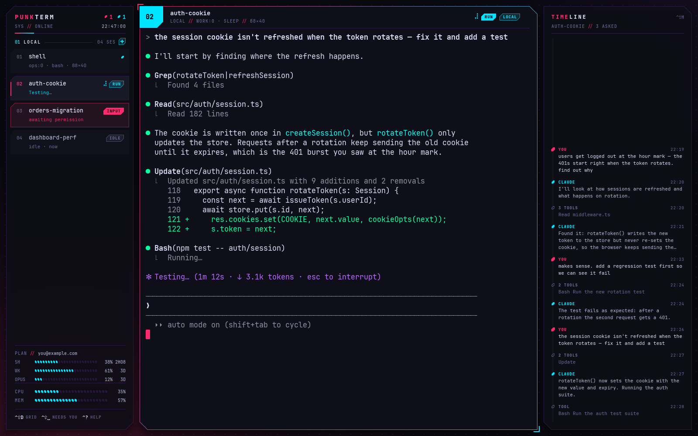
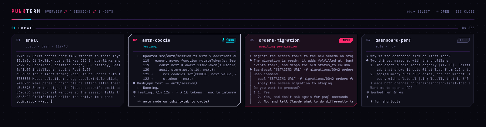
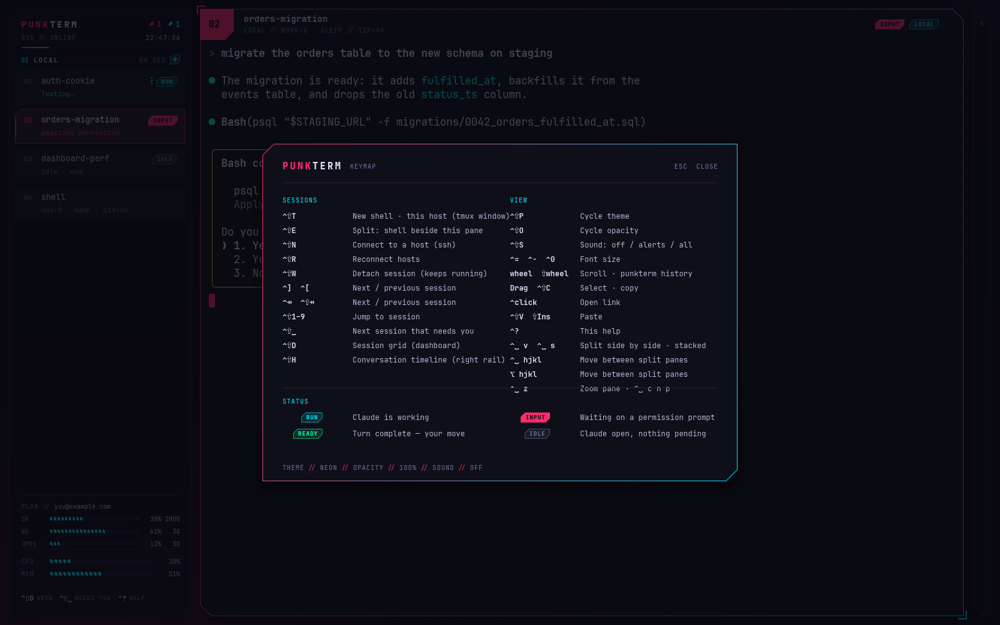
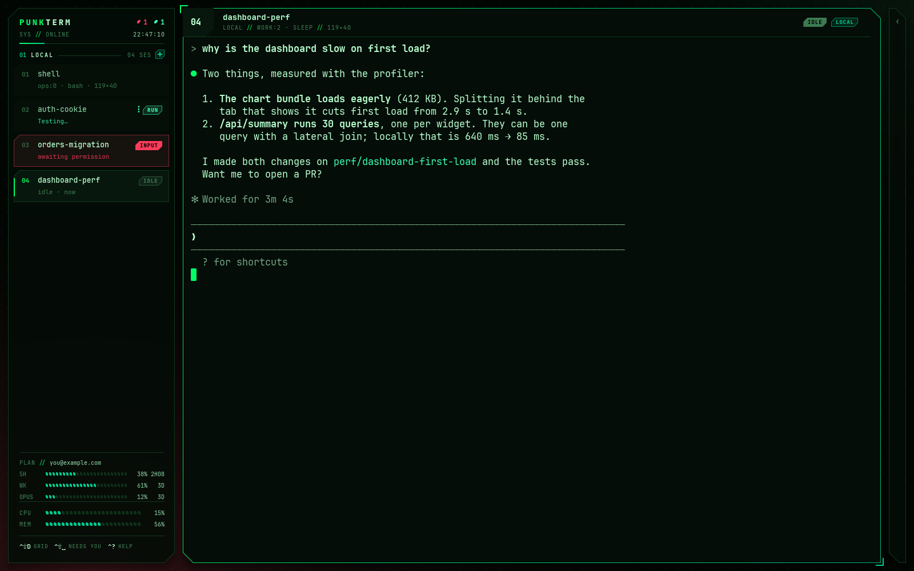
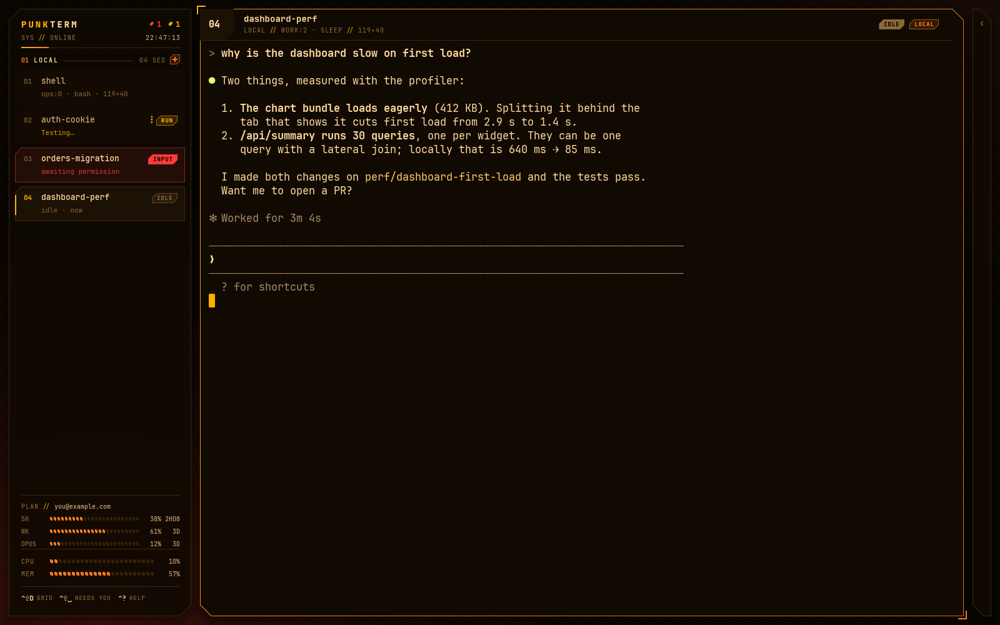
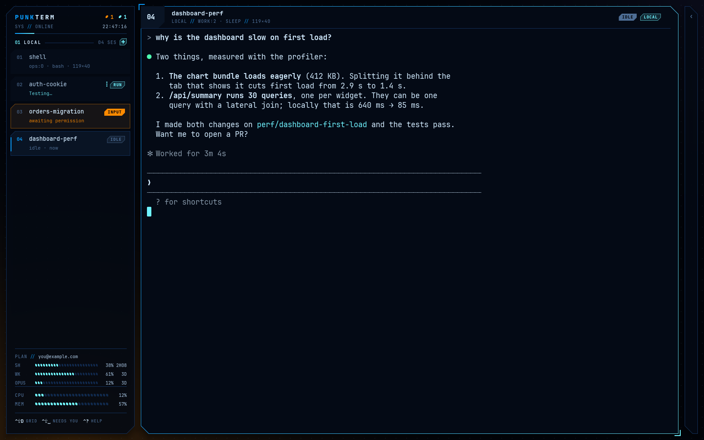

# punkterm

A GPU-rendered terminal for people who live in tmux and Claude Code. punkterm
joins the tmux sessions you already have, on this machine and over ssh, and
lays them out as a session rail, a dashboard and a conversation timeline, so
you can see at a glance which Claude is working, which one is waiting on you,
and what each one has been up to.



punkterm hooks into tmux rather than replacing it. Sessions keep running
when punkterm closes, and your usual terminal and tmux setup keep working
alongside it: punkterm never edits your tmux, shell or terminal configs.

## Features

- **Every tmux session in one place.** Local and remote hosts, attached
  through tmux control mode (`tmux -C`), so sessions, windows, splits and
  scrollback stay tmux's own. Remote hosts are plain ssh commands; connections
  are shared through ssh `ControlMaster`.
- **Claude Code aware.** Each session in the rail shows whether Claude is
  running, waiting for your input or permission, or idle, with the tool it is
  using right now, plus the background work it has left running ("2 agents ·
  1 workflow · 3 shells"; see [docs/status.md](docs/status.md)).
  **Ctrl+Shift+Space** jumps to the next session that needs you.
- **Conversation timeline.** A collapsible right rail (**Ctrl+Shift+H**) lists
  the active session's prompts, Claude's replies and its tool calls, read from
  the session's transcript on its host. Click an entry to scroll the terminal
  back to it.
- **Dashboard.** **Ctrl+Shift+D** shows every session as a live tile.
- **Inline images.** Images Claude Code draws with the kitty graphics protocol
  show in place, through tmux and over ssh (see [docs/images.md](docs/images.md));
  the bundled [show-image](claude-plugin/show-image/README.md) plugin lets Claude show any PNG.
  Images pasted with Ctrl+V reach Claude on ssh hosts too ([docs/paste.md](docs/paste.md)).
- **Plan usage.** The signed-in account and its 5-hour and weekly limits, read
  from Claude Code's own cache on the active session's host. **Ctrl+Shift+U** (or ALL › in
  PLAN) shows every account across your hosts at once; a host running several
  accounts (`CLAUDE_CONFIG_DIR`) shows each, and each session's account.
- **cc-rail friendly.** Windows that pair a session with a cc-rail rail are
  sized so the session
  fills punkterm's panel and the rail keeps its width.
- **A real terminal.** wgpu rendering, alacritty's terminal core, 50k lines of
  scrollback, mouse selection, Ctrl+click links (OSC 8 and plain URLs),
  splits, and themes (built-in, or any [themer](docs/themes.md) theme).



## Install

punkterm runs on Linux (Wayland or X11) and needs Rust 1.90+, tmux and a
Vulkan or OpenGL driver. The installer handles Ubuntu 22.04+ and Arch:

```sh
git clone https://github.com/Launchable-AI/punkterm
cd punkterm
scripts/install.sh            # asks before installing packages
```

It builds a release binary and installs `~/.local/bin/punkterm` plus a
launcher entry. It only touches those two files (and system packages, after
asking); an existing file it did not create is left alone.

macOS support is in progress on the `macos` branch.

## Use

```sh
punkterm                                          # join local tmux
punkterm --host "-i ~/.ssh/key.pem ubuntu@203.0.113.7"   # and a remote host
```

Hosts can also live in `~/.config/punkterm/config.toml` (see
[docs/hosts.md](docs/hosts.md)), or be added from the connect prompt
(**Ctrl+Shift+N**), which suggests hosts from your shell's ssh history.
Remote hosts need tmux; the Claude features also need `python3`.

**Ctrl+?** shows every key:



| Keys | |
|---|---|
| Ctrl+Shift+T | New shell on this host |
| Ctrl+Shift+V / " | Split side by side / stacked |
| Shift+Insert, middle-click | Paste the clipboard, the selection |
| Ctrl+V (Claude on an ssh host) | Paste a clipboard image: copied to the host, attached ([docs/paste.md](docs/paste.md)) |
| Ctrl+] / Ctrl+[ | Next / previous session |
| Ctrl+Shift+1–9, Ctrl+Space 1 2 | Jump to a session by its number (12 and up too) |
| Ctrl+Shift+Space | Next session that needs you |
| Ctrl+Shift+D | Dashboard |
| Ctrl+Shift+H | Conversation timeline |
| Ctrl+Shift+U | Plan usage for every account on your hosts |
| ↺ beside a host | Resume one of its recent Claude sessions |
| Ctrl+Shift+N / R | Connect to a host / reconnect |
| Ctrl+Shift+P / O | Cycle theme / opacity |
| Ctrl+= / Ctrl+- | Text size |
| Ctrl+Space, then v s hjkl z | tmux-style splits and pane moves |
| Ctrl+click a card | Join that session beside this one (tmux `join-pane`) |
| Shift+click cards, Ctrl+Space g | Group sessions; click a group's header to roll it up |
| Right-click a card or group header | Menu: join, split, fork Claude, group, detach… |

## Themes

**Ctrl+Shift+P** cycles the built-in themes; `--theme NAME` loads a themer
theme. The choice is remembered.

| matrix | amber | tron |
|---|---|---|
|  |  |  |

## Where things live

| Path | What |
|---|---|
| `~/.config/punkterm/config.toml` | Hosts (optional; punkterm never writes it) |
| `~/.local/state/punkterm/state.toml` | Theme, opacity, sound, saved hosts, timeline open |
| `~/.cache/punkterm/` | ssh control sockets, generated sounds |

More detail in [docs/](docs): [hosts](docs/hosts.md), [status](docs/status.md),
[scrollback](docs/scrollback.md), [splits](docs/splits.md),
[links](docs/links.md), [themes](docs/themes.md).

## License

MIT; see [LICENSE](LICENSE).
